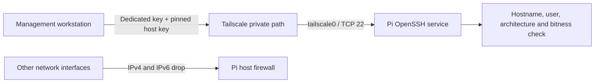

# Raspberry Pi Management over Tailscale

A small remote-management setup using **ordinary OpenSSH over Tailscale**:
explicit device targeting, independently verified host keys, a dedicated client
key, identity checks and persistent IPv4/IPv6 restrictions on SSH access.

The tools run on the management computer. The Pi keeps its existing operating
system and ordinary user account. This project is management infrastructure;
it does not implement robot control or install a coding agent on the Pi.



## Included

| File | Purpose |
| --- | --- |
| `scripts/check_pi.py` | Explicit SSH target and expected identity; stops on transport, authentication or identity failure; emits a fixed result without raw device details. |
| `examples/ssh_config.example` | Strict host-key checking, scoped key/pin files, BatchMode, no password fallback, PTY or forwarding. |
| `examples/authorized_keys.template` | Source-restricted public-key authorization example; no real key or address. |
| `firewall/ssh-tailnet-guard.sh` | Tagged, idempotent IPv4/IPv6 INPUT rules dropping TCP/22 outside `tailscale0`. |
| `firewall/ssh-tailnet-only.conf` | SSH service pre-start guard reference. |
| `tests/` | Offline identity, failure, privacy and firewall-behavior checks. |

## Configure and check

1. Confirm the Pi's hostname/account/architecture through an existing trusted
   terminal. Verify the server host-key fingerprint through that independent
   channel; a network scan alone does not establish trust.
2. Prepare a dedicated client key locally. Keep the private key on the management
   machine and exclude it from this repository. Pin the verified host key in a
   scoped known-hosts file. Do not accept a changed key automatically.
3. Adapt the example SSH configuration in a private copy. Its `192.0.2.x`
   addresses are documentation placeholders, not a working deployment.
4. Through trusted target access, add only the reviewed public key with
   `restrict` and an exact management-source restriction. Preserve other keys.
   Keep `.ssh` mode 700 and private key/config/pin files mode 600.
5. Run the identity check with explicit expectations:

```sh
python3 scripts/check_pi.py --config /path/to/private-ssh-config \
  --alias pi-management --host lab-pi --user pi --arch armv7l --bits 32
```

No target is selected by default. The helper checks all four identity fields
before returning success and makes no privileged remote changes. Its remote
script is sent over SSH; an SSH failure is never retried as a local command.
The SSH configuration must itself be trusted. These controls do not confine
what the authorized remote account can do in a separate shell session.

## Firewall persistence and recovery

The firewall files are **privileged references, not an automatic installer**.
Review the target, existing rules, `tailscale0`, TCP/22 and an independent local
recovery path before applying them. Do not run them on the management computer.

The guard checks for an exact tagged rule and inserts it at the front of INPUT
when absent, for both IPv4 and IPv6. It preserves unrelated rules and never
flushes tables. Non-Tailscale SSH, including loopback SSH, is blocked. The
exception does not itself grant access: normal SSH authentication and the
tailnet's access policy still apply.

The service drop-in expects a reviewed root-owned guard at
`/usr/local/sbin/pi-management-tailnet-only`. A rule-application error makes the
pre-start command fail. The two-family update is not atomic, and rule presence
does not prove effective ordering after unrelated firewall changes. Inspect
the full policy and test fresh allowed/denied connections; socket activation
must not bypass the guarded service startup.

Keep local/trusted recovery available. Roll back only these tagged rules and
the associated drop-in after deliberate review; do not flush or restore an old
full ruleset over Tailscale-managed state. Removing the guard can re-expose SSH
on other interfaces. This project does not create router forwards or public SSH.

## Validate offline

Python 3.10+, a POSIX shell and OpenSSH are used by the project:

```sh
python3 -m unittest discover -s tests -q
sh -n firewall/ssh-tailnet-guard.sh
ssh -G -F examples/ssh_config.example pi-management > /dev/null
```

Tests use fake identity/firewall commands and mocked SSH calls; they do not
contact a real device, read credentials or change any firewall. See
[evidence and limits](EVIDENCE.md) for the distinction between historical setup
results and publication checks.

This private repository is a one-time sanitized snapshot. Real addresses,
hostnames, fingerprints, keys and deployment logs are excluded. Original local
helpers and the live Pi remain unchanged, with no automatic synchronization or
deployment. No open-source license has been selected for this private snapshot.
